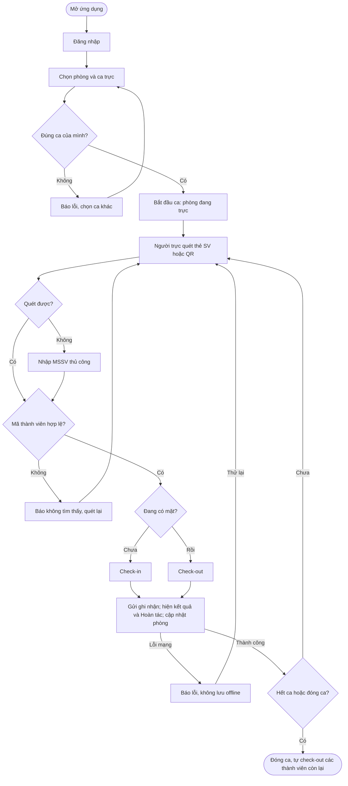
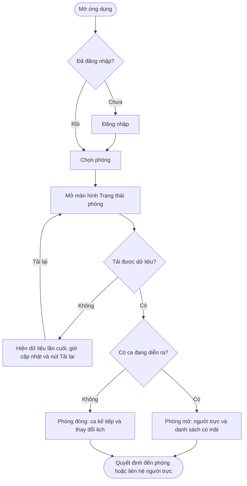

> Chuyển từ báo cáo Assignment 1 của nhóm; giữ các giới hạn bằng chứng và phân biệt kế hoạch với kết quả thực tế.
> Nguồn: [12_user_flows.tex](https://github.com/Big-Data-Club/BDCHub---DutyLog/blob/main/report/sections/12_user_flows.tex) · [PDF đầy đủ](https://github.com/Big-Data-Club/BDCHub---DutyLog/blob/main/report/main.pdf).

# Các luồng sử dụng chính

## Luồng 1: Người trực bắt đầu ca và ghi nhận thành viên

**Điểm bắt đầu:** người trực mở ứng dụng.

**Kết quả mong đợi:** thành viên được ghi nhận vào / ra, trạng thái phòng đúng, ca kết thúc đúng giờ.

**Chức năng:** F1, F2, F3, F4, F5, F6, F7.

**Flow 1: người trực bắt đầu ca và ghi nhận thành viên**

**Lưu ý đảo trạng thái:** hệ thống chọn check-in hay check-out theo trạng thái hiện tại của thành viên. Nếu một lượt trước bị bỏ sót, lượt sau sẽ ghi ngược; vì vậy kết quả mỗi lượt quét phải hiển thị rõ và cho phép hoàn tác ngay, và gửi lại cùng một lượt không được ghi trùng (BE-12).

**Lưu ý lỗi mạng:** nếu mất mạng khi ghi nhận, MVP không có hàng đợi offline; ứng dụng phải báo lỗi rõ ràng và cho thử lại hoặc nhập MSSV, không hiển thị như thể đã ghi nhận thành công.

## Luồng 2: Thành viên hoặc ban quản lý xem trạng thái phòng

**Điểm bắt đầu:** người dùng muốn biết tình hình phòng.

**Kết quả mong đợi:** biết phòng đang mở hay đóng, ai đang trực, ai đang có mặt, và quyết định đến phòng hoặc liên hệ người trực.

**Chức năng:** F1, F2, F7 (xem lịch ca của F2 khi phòng đóng).

**Flow 2: xem trạng thái phòng**

**Ghi chú “liên hệ người trực”:** MVP hiển thị tên người trực; việc liên hệ (gọi, nhắn) diễn ra ngoài ứng dụng.

**Ghi chú US8:** góc nhìn tập trung dành cho ban quản lý là giả thuyết A7 cần kiểm chứng trong pilot; khảo sát chưa hỏi trực tiếp nhóm này.

---

[Assignment 1](Assignment-1) · [Home](Home)
