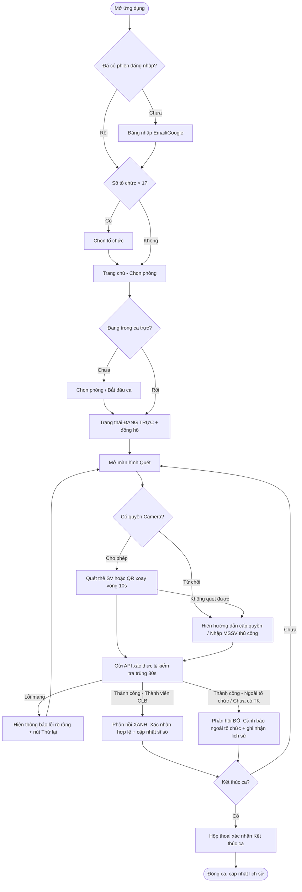
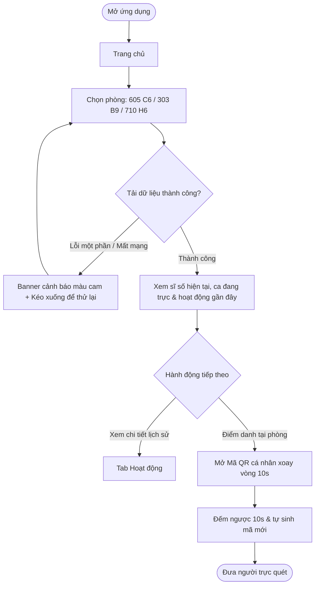
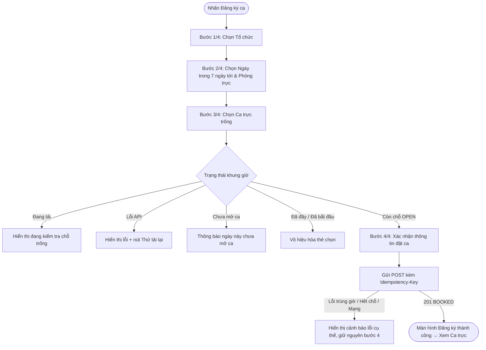

# A2 · Updated User Flows, Interaction States & Mobile UX

> Cập nhật từ [Các luồng sử dụng chính (Assignment 1)](A1-Critical-User-Flows) để đồng bộ với thiết kế giao diện và nguyên mẫu tương tác.

---

## 1. Cấu trúc điều hướng (Information Architecture)

Ứng dụng sử dụng **Bottom Tab Bar 5 mục** kết hợp các màn hình Stack/Modal cho tác vụ chuyên biệt:

- **Tab 1 — Trang chủ (`HOME`):** Thẻ trạng thái ca trực hiện tại (đồng hồ đếm giờ, sĩ số phòng, nút Quét / Kết thúc ca hoặc Đăng ký ca), thanh chọn nhanh phòng, 4 lối tắt nhanh (`Quét`, `Đăng ký ca`, `Mã QR của tôi`, `Lịch sử`), và danh sách *Hoạt động gần đây*.
- **Tab 2 — Ca trực (`SHIFTS`):** Danh sách ca đã đăng ký / lịch sử ca trực, hủy ca (trước 30 phút), nút mở luồng Đăng ký ca mới.
- **Tab 3 — Quét (`SCAN` — nút nổi trung tâm):** Mở trực tiếp màn hình quét điểm danh cho phòng đang chọn (nếu chưa chọn phòng sẽ điều hướng sang `RoomPickerScreen`).
- **Tab 4 — Hoạt động (`ACTIVITY`):** Nhật ký ra/vào chi tiết của phòng (thời gian vào/ra, trạng thái hợp lệ/ngoài tổ chức, bộ lọc).
- **Tab 5 — Cá nhân (`PROFILE`):** Thông tin thành viên, lối tắt mở Mã QR cá nhân, đổi tổ chức, trạm trực đầy đủ, quản trị (nếu có quyền Admin) và đăng xuất.

---

## 2. Updated Core User Flows

### Flow 1: Người trực vận hành ca & ghi nhận hiện diện (Check-in / Check-out)

### Flow 2: Thành viên xem trạng thái phòng & xuất trình Mã QR cá nhân

### Flow 3: Đăng ký ca trực 4 bước & Hủy ca

---

## 3. Ma trận Interaction States & Error Handling

| Màn hình / Luồng | Default / Active | Loading | Empty | Success / Confirm | Error & Recovery | Validation / Disabled / Permission |
|---|---|---|---|---|---|---|
| **Login** | Form email/mật khẩu + nút Google Sign-In | Spinner khi xác thực & khôi phục phiên | — | Chuyển thẳng vào Home / Chọn tổ chức | Báo lỗi sai thông tin, tài khoản chưa đăng ký BDC Hub, hoặc không kết nối được máy chủ | Disable nút khi thiếu trường hoặc đang gửi request |
| **Home (Trang chủ)** | Card `ĐANG TRỰC` (viền xanh + đồng hồ chạy) hoặc `CHƯA CÓ CA` | `Spinner` lần tải đầu + `RefreshControl` kéo làm mới | `Empty` *"Chưa có lượt điểm danh"* | Hộp thoại xác nhận trước khi *Kết thúc ca* | Banner cam *"Một phần dữ liệu chưa tải được... Kéo xuống để thử lại"* + trạng thái `Chưa xác định được trạng thái ca trực` | — |
| **Scan Check-in** | Khung camera Barcode / QR + chuyển đổi chế độ | Trạng thái đang xác thực mã với server | — | Thẻ phản hồi **Xanh** (hợp lệ), rung haptic | Thẻ cảnh báo **Đỏ** (ngoài tổ chức / QR hết hạn / trùng quét 30s) + báo lỗi mạng kèm nút thử lại | Xin quyền Camera; nếu từ chối → hiện thông báo & chuyển sang nhập MSSV thủ công |
| **Personal QR** | Hiển thị mã QR + thanh đếm ngược 10 giây | Đang tạo mã token mới | — | Tự động làm mới mã liên tục | Báo lỗi khi không tạo được token mới + nút thử lại | — |
| **Shift Registration (4 bước)** | Stepper 1→4, thẻ chọn có viền xanh khi active | *"Đang tải phòng…"* / *"Đang kiểm tra chỗ trống…"* | *"Ngày này chưa được quản trị viên mở ca"* | Màn hình `RegistrationSuccessScreen` kèm tóm tắt phòng/ngày/giờ | Lỗi tải lịch (+ nút *Thử tải lại*); lỗi submit 409 (trùng giờ / hết chỗ) hiển thị rõ | Disable nút *Tiếp tục* khi chưa chọn; disable slot `FULL` hoặc `STARTED` |
| **Shifts / Activity** | Danh sách ca / lượt ra vào phân màu chip Xanh (Vào) / Cam (Rời) | Spinner / kéo làm mới | Empty state có icon + mô tả hướng dẫn | Xác nhận hủy ca | Báo lỗi nếu quá hạn hủy (dưới 30 phút trước giờ trực) | Ẩn/vô hiệu hóa nút hủy khi ca đã bắt đầu hoặc đã hủy |

---

## 4. Mobile-Specific Design & Accessibility

Áp dụng hướng dẫn từ **Apple Human Interface Guidelines (HIG)** và **Material Design 3**:

- **Touch targets & One-handed reachability:** Nút chính `ActionButton` có `minHeight: 48px`, nút quay lại `42×42px`, biểu tượng shortcut `49×49px`; nút hành động thường dùng nhất (`Quét`) đặt nổi ở giữa Bottom Tab Bar để dễ thao tác bằng ngón cái một tay tại cửa phòng.
- **Input minimization:** Ưu tiên quét camera (thẻ SV / QR) thay vì gõ tay; luồng đăng ký ca dùng chip ngày nằm ngang và thẻ chọn sẵn thay vì nhập form chữ.
- **Readability & Color contrast:** Hệ màu nền sáng `#F2F4F8`, thẻ trắng `#FFFFFF`, chữ chính `#111A2E` đảm bảo độ tương phản cao; trạng thái không bao giờ chỉ dựa vào màu sắc mà luôn đi kèm nhãn chữ (`Vào phòng`, `Rời phòng`, `Còn chỗ`, `Đã đầy`) và icon phân biệt.
- **Accessibility:** Gắn `accessibilityRole` (`button`, `tab`, `alert`), `accessibilityState` (`disabled`, `selected`), `accessibilityLabel` cho icon/nút không chữ.
- **Interruption & Recovery:** Khôi phục phiên an toàn qua Keystore/Keychain (`expo-secure-store`), dùng `Idempotency-Key` chống đặt trùng khi mạng chập chờn, khóa quét lặp nhanh trên thiết bị (12 giây) và chống ghi trùng phía máy chủ (30 giây).

---

[Assignment 2](Assignment-2) · [Product Refinement & MVP](A2-Product-Refinement-and-MVP) · [Design System & Prototype](A2-Design-System-and-Prototype)
