# 21 · CI/CD, Release Gates, and Supply-Chain Safety

> **Status:** Release engineering proposal; inspect live workflows before claiming implementation · **Reviewed:** October 13, 2026

## The CoreApplication integration constraint

DutyLog is referenced as a Git submodule in CoreApplication. Merging into the DutyLog repository does not automatically update the revision running in CoreApplication. A release must explicitly select the intended submodule gitlink SHA and deployed container image digest. Run backend and Expo checks independently where possible to reduce CI time, but keep contract boundaries covered.

## Recommended delivery pipeline

```mermaid
flowchart LR
 PR[Pull request] --> STATIC[Formatting, types, vet]
 STATIC --> UNIT[Unit and contract tests]
 UNIT --> INTEGRATION[PostgreSQL / Redis integration]
 INTEGRATION --> BUILD[Reproducible image build]
 BUILD --> SECURITY[Dependency scan / SBOM]
 SECURITY --> STAGING[Deploy to staging]
 STAGING --> SMOKE[API and Expo smoke tests]
 SMOKE --> APPROVE[Maintainer approval]
 APPROVE --> PROMOTE[Pin image digest and Core submodule SHA]
 PROMOTE --> MONITOR[Readiness and release monitoring]
 MONITOR --> ROLLBACK[Rollback if gate fails]
```

## Suggested GitHub Actions jobs

- `backend-static`: pin compatible Go, run `gofmt`, `go vet`, and unit tests; run race tests on a CI runner with adequate resources; cache `~/go/pkg/mod` by `go.sum`.
- `mobile-static`: pin Node, run `npm ci`, `npx tsc --noEmit`, and an Expo Web bundle smoke test compatible with the locked Expo SDK.
- `db-integration`: ephemeral PostgreSQL and Redis, migrations, synthetic JWT claims, deterministic fixtures, and teardown.
- `contract-check`: schema fixtures, negative authorization matrix, and backward compatibility tests.
- `container-build`: minimal Go multi-stage Docker build, non-root runtime, pinned architecture, SBOM and security scan, publish by commit SHA/digest.
- `deploy-staging`: protected branch/environment approval, health and business smoke tests, promotion only after evidence review.

## CI time and cost optimizations

Use path filters for `backend/**` and `mobile/**`, while ensuring shared contract and dependency changes trigger both relevant suites. Cancel superseded PR workflow runs. Cache dependency downloads by lockfile; avoid blindly caching `node_modules`. Reuse built artifacts. Do not run expensive native camera E2E for documentation-only changes.

## Supply-chain controls

Pin third-party GitHub Actions to immutable commit SHAs, declare least-privilege workflow `permissions:`, keep secrets unavailable to untrusted fork pull requests, and use environment-scoped credentials. Maintain dependency update alerts, vulnerability triage, artifact retention, and rollback evidence. Never deploy mutable `:latest` images as the sole release reference.

## Release checklist

- [ ] API/contract diffs and database migration plan approved.
- [ ] Static/unit/contract/integration checks passed at the release SHA.
- [ ] Container digest recorded; SBOM/security findings reviewed.
- [ ] CoreApplication submodule points to the intended DutyLog commit.
- [ ] Approved **staging** smoke cases cover health, authentication, organizations, rooms, and positive/negative scanning.
- [ ] Observability dashboard, on-call owner, alerting, and rollback command exist.

## Rollback caveat

Reverting an app image or Git submodule does **not** reverse database schema mutations. Design additive migrations so an older compatible application can run during rollback, and define a manual recovery plan for destructive schema/data changes. Never run `git reset --hard` in a workspace with uncommitted changes unless they are explicitly disposable.

## Source references

- [workflows](https://github.com/Big-Data-Club/BDCHub---DutyLog/tree/main/.github/workflows)
- [CONTRIBUTING.md](https://github.com/Big-Data-Club/CoreApplication/blob/main/CONTRIBUTING.md)

---
[Home](Home) · [API Contract](API-Contract) · [Roadmap & Backend Gaps](Roadmap-and-Backend-Gaps)
