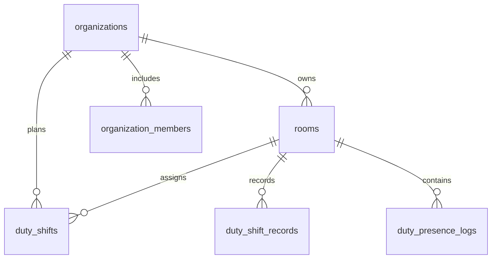

# 08 · PostgreSQL Data Model, Migrations, and Consistency

> **Status:** V001–V003 observed in public source; V004 exists only in the v2 overlay · **Reviewed:** October 13, 2026

## Tables defined in the referenced source

| Table | Purpose | Important keys / constraints |
|---|---|---|
| `organizations` | Organization metadata | `id`, unique `slug`, `is_active` |
| `rooms` | Rooms belonging to organizations | `id`, `organization_id`, `capacity` |
| `organization_members` | Local membership projection | `UNIQUE(organization_id, user_id)` |
| `duty_shifts` | Recurring weekly shift assignments | `assigned_student_id`, `day_of_week`, `start_time` |
| `duty_shift_records` | Actual started/ended shifts | `status`, `start_time`, `end_time` |
| `duty_presence_logs` | Check-in/check-out audit records | `check_in_at`, `check_out_at`, `client_scan_uuid` |

The referenced V001–V003 approach uses `CREATE TABLE IF NOT EXISTS` and `ALTER TABLE IF NOT EXISTS` statements. No complete version-history/rollback mechanism was observed in `db.go`, and startup currently warns rather than failing on migration errors. Standardize migration ownership, make schema readiness explicit, and rehearse backups before destructive changes.

## Booking schema — v2 merge candidate

- `duty_slots`: organization, room, ISO weekday (1–7), start/end times, capacity, active state.
- `duty_registrations`: user, organization, room, slot, duty date, booking state (`BOOKED`/`CANCELLED`), idempotency key.
- Unique `(user_id, idempotency_key)` and partial uniqueness for an active `(slot_id, duty_date, user_id)` booking.
- Slot row locking and a per-user advisory transaction lock to prevent overbooking and cross-room overlapping bookings.
- The overlay adds its own migration hook; none of this is assumed to have been deployed.

## Database invariants

1. A booking cannot reference a room outside its organization.
2. Active bookings for a slot/date cannot exceed capacity, even under concurrency.
3. A member has at most one active booking for the same slot and date.
4. Retrying a check-in must not create multiple active presence sessions.
5. Check-out must not produce a negative duration; server time is authoritative for reporting.

## Safe migration procedure

1. **Expand:** introduce backward-compatible nullable or default-safe columns; use concurrent index creation for large PostgreSQL tables when appropriate.
2. Deploy compatible readers and writers without removing fields old versions still use.
3. Backfill in bounded batches, monitoring locks, replication lag, and query performance.
4. **Contract:** remove legacy columns only when every consumer has migrated.
5. Maintain a forward plan, verified backup, rollback strategy, and documented migration operator.

Use `EXPLAIN (ANALYZE, BUFFERS)` on representative staging data. A typical room history query benefits from a `(room_id, check_in_at DESC)` index; active occupancy may need a partial index depending on the actual SQL predicates. Validate each index against real query plans rather than creating speculative indexes.

## Review checklist

- [ ] Schema and handler field types agree.
- [ ] Constraints are enforced by PostgreSQL, not just TypeScript validation.
- [ ] Critical migration failure prevents a supposedly ready instance from serving writes.
- [ ] Tenant-specific keys and foreign keys prevent cross-organization corruption.
- [ ] Concurrency and rollback tests run on an isolated staging database.

## Source references

- [db.go](https://github.com/Big-Data-Club/BDCHub---DutyLog/blob/main/backend/internal/db/db.go)
- [ARCHITECTURE.md](https://github.com/Big-Data-Club/BDCHub---DutyLog/blob/main/docs/ARCHITECTURE.md)

---
[Home](Home) · [API Contract](API-Contract) · [Roadmap & Backend Gaps](Roadmap-and-Backend-Gaps)
