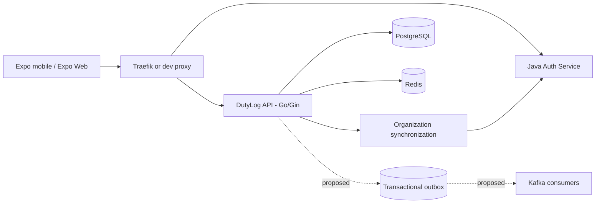

# DutyLog — Project Entry Point

## Assignment 1 — Product Discovery & Foundation

**Course:** CO3043 — Mobile Application Development

**Group:** L02_MƯỜI GIỜ KÉM BẢY

- [Assignment 1: report, documentation, project board and research evidence](Assignment-1)
- [GitHub Organization](https://github.com/Big-Data-Club)
- [GitHub Repository](https://github.com/Big-Data-Club/BDCHub---DutyLog)
- [GitHub Project Board — DutyLog](https://github.com/orgs/Big-Data-Club/projects/3)
- [Figma Prototype — DutyLog](https://www.figma.com/make/edHYn86d06Uh95uwZJ1Wqm/DutyLog?fullscreen=1&t=mm4kpDhtha3xpPrq-1&code-node-id=0-6)

**Preparation status:** The report, Wiki and project board were publicly accessible when checked on October 20, 2026. Original research evidence and team GitHub membership still need completion; see Assignment 1 for details.

## Engineering Handbook

> **Last reviewed:** October 13, 2026 · **Status:** Overview / partially verified against public source  
> Examples explain engineering intent, not proof of deployed functionality. Always compare with the commit running in your environment.

DutyLog is the BDC Hub application for managing shared-room presence, duty shifts, member check-ins, and attendance history across Big Data Club organizations. This handbook serves new contributors, React Native and web developers, backend engineers, QA, site reliability engineers, and CoreApplication maintainers.

## Find your way around

| Your objective | Start here | Continue with |
|---|---|---|
| Run Expo Web on Ubuntu or view it on an iPhone | [Getting Started](Getting-Started) | [Expo Web and iPhone](Expo-Web-and-iPhone), [Troubleshooting](Troubleshooting) |
| Understand QR and attendance flows | [System Architecture](System-Architecture) | [Presence and QR](Presence-and-QR-Flow), [Data Model](Data-Model-and-Migrations) |
| Add an API or fix Go code | [Repository Map](Repository-and-Code-Map) | [API Contract](API-Contract), [Authentication and Authorization](Authentication-and-Authorization) |
| Implement duty-slot booking | [Shift Registration](Shift-Registration) | [Transactions and Idempotency](Transaction-and-Idempotency) |
| Benchmark high-throughput scans | [Performance Engineering](Performance-Engineering) | [Kafka and Outbox](Kafka-and-Outbox), [Testing Strategy](Testing-Strategy) |
| Deploy through CoreApplication | [Deployment](Deployment-CoreApplication) | [CI/CD](CI-CD-and-Release), [Incident Runbooks](Incident-Runbooks) |
| Assign or review remaining work | [Roadmap and Backend Gaps](Roadmap-and-Backend-Gaps) | [Contributing](Contributing) |

## Architecture at a glance

## Evidence and delivery status

- **Verified in public source:** Go HTTP routes and authentication middleware, PostgreSQL V001–V003 definitions, Redis integration, organization synchronization, Expo SDK 51, and the CoreApplication Traefik setup.
- **Merge candidate:** The October 12 v2 overlay adds duty-slot availability, bookings, cancellation, and a four-step registration interface. Do not assume these changes exist on `main` or production.
- **Proposed / needs verification:** durable event outbox, DutyLog Kafka consumers, offline `/sync-batch`, scan latency SLOs, no-loss performance evidence, and full iPhone/Safari scanning support.

## Engineering principles

1. **The server is authoritative.** Report a scan or reservation as successful only after a durable server acknowledgment.
2. **Authentication is not authorization.** A valid JWT alone does not grant permission to scan, edit, or inspect every room.
3. **Enforce organization boundaries.** Check resource ownership and role permissions on every relevant read and write.
4. **Make retries safe.** Repeated requests caused by weak Wi-Fi must not create duplicate business operations.
5. **Benchmark safely.** Use approved staging infrastructure, synthetic identities, and a defined load envelope—not production.
6. **Protect sensitive information.** Keep secrets, raw QR tokens, complete student IDs, and personal data out of public documentation and issue logs.

## Canonical project links

- [DutyLog repository](https://github.com/Big-Data-Club/BDCHub---DutyLog)
- [CoreApplication repository](https://github.com/Big-Data-Club/CoreApplication)
- [Architecture reference](https://github.com/Big-Data-Club/BDCHub---DutyLog/blob/main/docs/ARCHITECTURE.md)
- [API specification](https://github.com/Big-Data-Club/BDCHub---DutyLog/blob/main/docs/API_SPECIFICATION.md)
- [Architecture Decision Records](https://github.com/Big-Data-Club/BDCHub---DutyLog/tree/main/docs/adr)

**Maintainer rule:** changes to an API, schema, event, authorization decision, or deployment contract must update the reviewed technical source and its Wiki explanation in the same release cycle.
