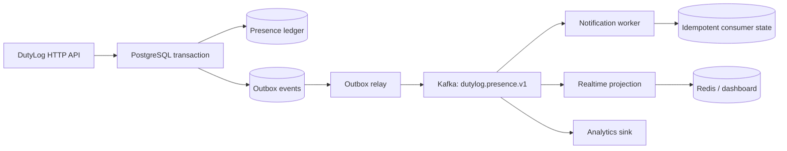

# 13 · Kafka, Transactional Outbox, and Consumer Reliability

> **Status:** Kafka infrastructure configured; DutyLog producers and consumers not established · **Reviewed:** October 13, 2026

## Should Kafka sit on the scanning critical path?

**Not by default.** Kafka is useful for event fan-out, notifications, analytics, and downstream projections. It should not become a prerequisite for the HTTP response when the user requires confirmation that a presence record has been durably saved in PostgreSQL.

CoreApplication Compose includes a KRaft Kafka broker (`kafka:9092`) and declares `KAFKA_BROKERS` and `KAFKA_PRESENCE_TOPIC` for DutyLog. The inspected public `backend/go.mod` does not list a direct Kafka client library. Infrastructure configuration by itself **does not demonstrate that DutyLog publishes or consumes events**. Verify actual code paths and integration tests.

## Proposed pipeline



Insert the business row and its outbox message **within one SQL transaction**. A separate worker publishes after the commit. A crash can cause duplicate publication; consumers deduplicate by stable `event_id`. Describe this as *at-least-once transport with idempotent business effects*, not end-to-end exactly-once delivery.

## Example outbox schema (proposed)

```sql
CREATE TABLE outbox_events (
  id UUID PRIMARY KEY,
  aggregate_type TEXT NOT NULL,
  aggregate_id TEXT NOT NULL,
  event_type TEXT NOT NULL,
  payload JSONB NOT NULL,
  occurred_at TIMESTAMPTZ NOT NULL DEFAULT NOW(),
  published_at TIMESTAMPTZ,
  attempts INTEGER NOT NULL DEFAULT 0
);
CREATE INDEX ON outbox_events (occurred_at)
  WHERE published_at IS NULL;
```

Use `SELECT ... FOR UPDATE SKIP LOCKED` to coordinate multiple relays. Publication and marking an event delivered still span separate systems, so a crash between Kafka ACK and `published_at` update may publish again. Consumers **must be idempotent**.

## Versioned event envelope (illustrative)

```json
{
  "event_id": "<uuid>",
  "schema_version": "1.0",
  "event_type": "CHECK_IN",
  "organization_id": 1,
  "room_id": "CS1-303-B9",
  "student_id": "<pseudonymous-id>",
  "occurred_at": "2026-10-13T10:00:00Z",
  "recorded_at": "2026-10-13T10:00:00Z"
}
```

This is not a replacement for the current documented event schema, which uses fields such as `event_version`, `timestamp`, and `student_name`. Any schema revision requires explicit versioning, compatibility tests, and a reviewed ADR. Avoid publishing personal data that a consumer does not require.

## Partitioning, retries, and dead-letter queues

- Using a stable `room_id` as the Kafka message key preserves room-local ordering within a partition but can make a single busy room a hot partition.
- Commit consumer offsets only after the business side effect has been durably applied; persist an `event_id` dedup marker where appropriate.
- Apply bounded retries with exponential backoff and jitter. Send poison messages to a monitored DLQ with reason, trace ID, and remediation instructions.
- Monitor broker and consumer health, consumer lag, oldest pending event age, retry counts, and differences between committed database rows and downstream events.

## Decision criteria: when to adopt Kafka

1. First benchmark a PostgreSQL-only scan implementation at 10, 50, 200, and 1,000 requests/second under controlled staging resources.
2. Identify actual bottlenecks: connection pool, locks, transaction time, Redis, routing, or CPU.
3. Add outbox + Kafka when replay, independent fan-out consumers, and operational capacity justify it.
4. For a small room board, SSE or bounded polling may be operationally simpler than Kafka/WebSockets.

## Fault-injection acceptance

Disable Kafka for thirty minutes while allowing committed HTTP scans; verify outbox growth, successful catch-up after recovery, no missing business events, no duplicated consumer effects, observable DLQ, and bounded replay lag. Do not claim this behavior until measured.

## Source references

- [go.mod](https://github.com/Big-Data-Club/BDCHub---DutyLog/blob/main/backend/go.mod)
- [docker-compose.yml](https://github.com/Big-Data-Club/CoreApplication/blob/main/docker-compose.yml)
- [ARCHITECTURE.md](https://github.com/Big-Data-Club/BDCHub---DutyLog/blob/main/docs/ARCHITECTURE.md)

---
[Home](Home) · [API Contract](API-Contract) · [Roadmap & Backend Gaps](Roadmap-and-Backend-Gaps)
