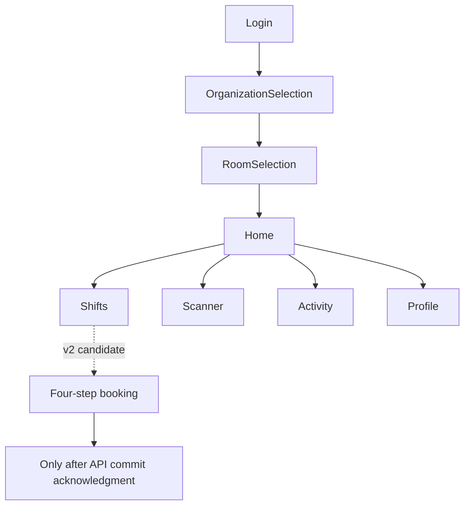

# 15 · Mobile Architecture, Navigation, and State Management

> **Status:** Public Expo dependencies verified; redesigned screens are merge candidates · **Reviewed:** October 13, 2026

## Current technology baseline

The public `mobile/package.json` references Expo SDK 51, React Native 0.74, `expo-camera`, `expo-barcode-scanner`, `expo-secure-store`, and `lucide-react-native`. The v2 UI overlay proposes additions such as `src/screens/v2`, `src/ui/Kit.tsx`, and `src/api/reservations.ts`. Confirm their presence in the **current checkout** before documenting them as merged.

## Separation of responsibilities

```text
Application navigation
  -> Feature screens
      -> Reusable design-system components
          -> Typed feature API adapters
              -> Auth/session storage adapter
                  -> HTTPS API gateway
```

Candidate v2 responsibilities:

- `src/ui/theme.ts`: design tokens for typography, color, spacing, radius, elevation.
- `src/ui/Kit.tsx`: accessible buttons, cards, tabs, badges, loading indicators.
- `src/api/client.ts`: existing Auth/DutyLog API and legacy paths requiring a false-success audit.
- `src/api/reservations.ts`: typed booking client for additive v2 endpoints.
- `src/platform/sessionStore.ts`: platform-sensitive session handling with separate web/native security considerations.

Never ship demo tokens, fabricated check-ins, or automatic mock-success behavior in production code. When the server is unreachable, display a real failure or a clearly labeled durable pending operation.

## Mandatory remote-data states

Each network-backed screen distinguishes **Loading**, **Success**, **Empty**, **Error**, and **Offline Pending** if offline mode is implemented. An API failure cannot be rendered as an empty data set. The previously observed CORS problem on `/user/organizations` illustrates the risk: a failed request incorrectly appeared to the user as “No organizations found.”

## Navigation map



## Screen-to-API inventory

| Screen | Data source | Reliability and UX contract |
|---|---|---|
| Login | Java Auth Service | No synthetic credential fallback; meaningful 401 feedback. |
| Organizations | GET `user/organizations` | Distinct loading/error/empty, membership filters. |
| Rooms | GET organization rooms | Enforce organization scope and preserve selected room context. |
| Dashboard | Active shift, occupancy, recent history | Server-confirmed state, explicit freshness. |
| Scanner | Check-in, check-out, QR endpoints | Local debounce for UX only; backend idempotency required. |
| Activity | Duty and presence histories | Server timestamps, pagination, privacy controls. |
| Booking wizard | Availability and registrations | **v2 merge candidate only**; server rechecks quota. |
| Profile | Identity/session and QR generation | No secret leakage into screenshots or logs. |

## Accessibility and responsive behavior

Provide touch targets of at least 44×44 CSS pixels, readable contrast (WCAG AA for essential text), accessible icon labels, logical focus order, reduced-motion support, and good keyboard avoidance on iPhone XS Max. Do not stretch narrow mobile cards edge-to-edge on a large desktop canvas; define a maximum content width.

## Known compatibility issues

An older installed `lucide-react-native` may not export `House` (`TS2724`). Use an icon actually exported by the locked dependency and re-run `npx tsc --noEmit`. `props.pointerEvents is deprecated` can be a nonfatal React Native Web warning; investigate bundler and runtime errors separately.

## Source references

- [package.json](https://github.com/Big-Data-Club/BDCHub---DutyLog/blob/main/mobile/package.json)
- [client.ts](https://github.com/Big-Data-Club/BDCHub---DutyLog/blob/main/mobile/src/api/client.ts)

---
[Home](Home) · [API Contract](API-Contract) · [Roadmap & Backend Gaps](Roadmap-and-Backend-Gaps)
