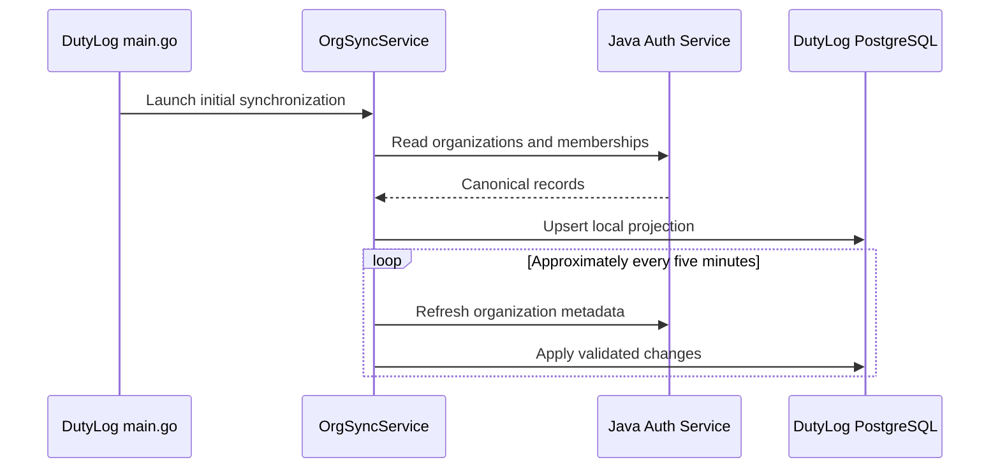

# 07 · Synchronizing Organizations from the Auth Service

> **Status:** Startup and periodic synchronization observed; security policy proposed · **Reviewed:** October 13, 2026

## Why synchronize?

The Java Auth Service owns canonical organizations and membership records. DutyLog needs a local projection to support room lookups, booking checks, and organization isolation without making every read dependent on a network call. Do not independently seed conflicting organizations if the authoritative source is available.

## Observed synchronization behavior

The public `main.go` launches an initial asynchronous sync with a 20-second timeout and schedules a recurring five-minute refresh. The router exposes `POST /api/v1/sync/organizations` under `OptionalAuth`: verify handler enforcement and service-to-service authorization as a **P0 security concern**. Local tables include `organizations` and `organization_members`; preserve canonical IDs from Auth.

## Consistency and data-loss risks

- Membership revocation in Auth may not reach DutyLog for several minutes, or longer during an outage. Privileged actions need a documented maximum membership age or a fresh authorization lookup.
- Never mass-delete local memberships when the upstream returns a 500, a truncated response, or invalid JSON. Apply only a validated, complete snapshot or a well-defined delta.
- Record a sync run ID, source revision or timestamp, inserts/updates/deletes, duration, errors, retry count, and projection age.
- Restrict manual synchronization to a verified service credential or administrator policy; rate-limit and audit triggers.

## Troubleshooting an empty organization screen

| Browser/API observation | Likely cause | What to check |
|---|---|---|
| `OPTIONS 404`, missing CORS headers | Browser blocked preflight | Network request URL, origin, gateway, response headers |
| `GET 401/403` | Token or membership issue | Test JWT, Auth membership, tenant policy |
| `GET 200` with zero organizations | No memberships or lagging sync | Canonical memberships, last successful sync |
| `GET 200` with nonempty list but blank UI | Response parsing or filter bug | Response envelope, selected filters, stale client state |
| `GET 502/503` | Gateway or upstream unavailable | Traefik routing, service health, network policy |

**Never display “No organizations found” when the API request failed.** Distinguish loading, failed, empty, and successful states in the component.

## Required integration tests

- Adding a membership in Auth appears in DutyLog within the documented freshness window.
- Changing or revoking a role removes authorization within the specified window.
- A sync failure does not erase an otherwise valid local projection.
- A user who belongs to two organizations sees only authorized organizations unless an approved global role applies.
- A user cannot repeatedly trigger expensive synchronization without authorization or throttling.

## Source references

- [main.go](https://github.com/Big-Data-Club/BDCHub---DutyLog/blob/main/backend/cmd/server/main.go)
- [ARCHITECTURE.md](https://github.com/Big-Data-Club/BDCHub---DutyLog/blob/main/docs/ARCHITECTURE.md)

---
[Home](Home) · [API Contract](API-Contract) · [Roadmap & Backend Gaps](Roadmap-and-Backend-Gaps)
