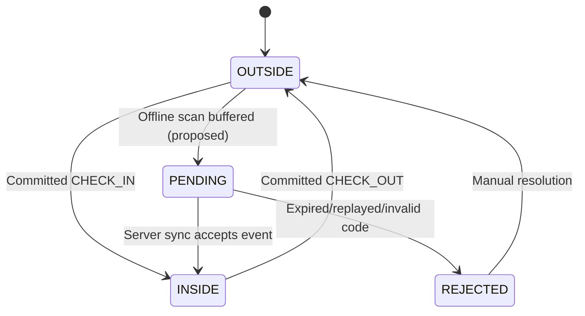
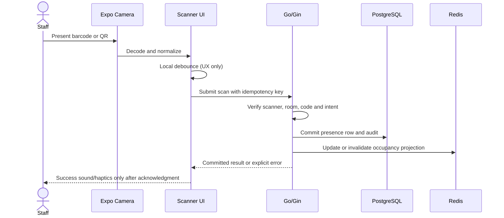

# 11 · QR, Barcode, and the Presence State Machine

> **Status:** Public routes verified; scanner security and latency targets need validation · **Reviewed:** October 13, 2026

## Different code types imply different trust levels

- **Static student-card barcode:** identifies a card number but can be copied; by itself it does not prove that the rightful cardholder is physically present.
- **Rotating personal QR:** the public router has `POST /qr/generate` and `POST /rooms/:room_id/checkin-qr`. Comments refer to rotation every ten seconds, but handler-level token expiry, nonce uniqueness, and replay defense still need verification.
- **Manual student ID entry:** a controlled fallback that requires actor logging, rate limiting, and anti-enumeration controls.

## Presence state machine

An automatic IN/OUT mode must decide the action using durable server state inside the transaction, not infer a person's location solely from time or a client toggle. Offline events arriving later may require an explicit conflict-resolution policy.

## Expected synchronous scan sequence

## Existing router entry points

- `POST /api/v1/rooms/:room_id/checkin`
- `POST /api/v1/rooms/:room_id/checkout`
- `POST /api/v1/rooms/:room_id/checkin-qr`
- `POST /api/v1/qr/generate`

The repository's API specification describes fields including `student_id`, `method`, and `client_timestamp`. Read the actual handlers before asserting support for idempotency headers or QR validity windows.

## Security requirements

- Bind signed QR data to subject, purpose, issuer, `issued_at`, and `expires_at`; consider one-time nonce usage with HMAC or EdDSA signatures.
- Never embed plaintext full names, student identifiers, or access tokens in an unprotected QR URL or public log.
- Defend against replay through an atomic marker such as Redis `SET NX EX` **or** a durable unique nonce constraint, with documented expiry and cleanup.
- Enforce scan rate limits by scanner identity, user, and room; apply a stricter policy to manual entry.
- Reject expired QR credentials explicitly. Never silently fall back to unauthenticated success.

## Latency decomposition and acceptance

Measure camera decode, network round trip, server duration, database commit, and UI confirmation separately. An example **proposed** end-to-end p95 goal is under 500 ms on good campus Wi-Fi; no measured result is claimed here.

## Test coverage

Real iPhone camera versus Firefox UI preview; expired, tampered, and replayed QR tokens; loss of connectivity; duplicate taps; two scanners scanning the same code concurrently; unauthorized cross-organization access; Redis reset and recovery; device clock skew of ±5 minutes.

## Source references

- [API_SPECIFICATION.md](https://github.com/Big-Data-Club/BDCHub---DutyLog/blob/main/docs/API_SPECIFICATION.md)
- [main.go](https://github.com/Big-Data-Club/BDCHub---DutyLog/blob/main/backend/cmd/server/main.go)

---
[Home](Home) · [API Contract](API-Contract) · [Roadmap & Backend Gaps](Roadmap-and-Backend-Gaps)
