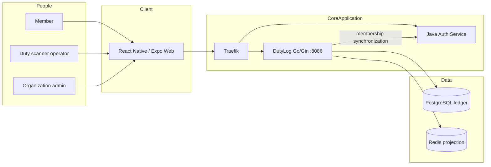
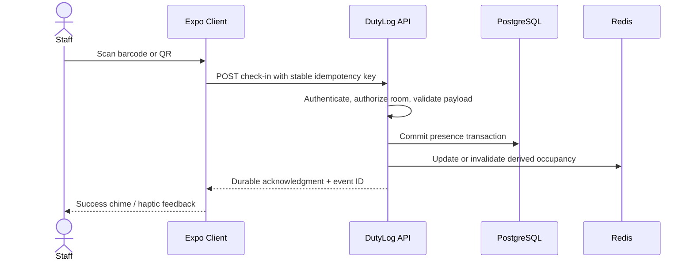

# 04 · System Architecture and Data Flow

> **Status:** Deployment topology verified in source; reliability path proposed · **Reviewed:** October 13, 2026

## Logical architecture

The referenced CoreApplication Compose file declares DutyLog on port **8086** and exposes `/dutylogapiv1`, rewritten to `/api/v1/*` by the gateway. It refers to `postgres-lms` for PostgreSQL and `redis-lms` DB 4 for Redis. A K3s deployment may differ; verify the installed environment rather than assuming Compose matches production.

## Startup sequence observed in `main.go`

1. `db.Connect()` initializes and pings the SQL connection pool.
2. `rds.Connect()` initializes Redis.
3. `db.RunMigrations()` applies V001–V003. In the referenced source, a migration failure logs a warning and startup continues; this is a readiness hazard.
4. `OrgSyncService` starts an asynchronous organization synchronization from Auth.
5. A five-minute ticker schedules periodic synchronization.
6. `gin.Default()` exposes `/healthz` and `/api/v1/*` routes.

## Proposed scan critical path

This is an **acceptance target**, not an assertion that every existing handler executes the operations in this order. PostgreSQL and Redis do not share an ACID transaction; anchor correctness in the database and treat cache updates as recoverable work.

## Consistency requirements

| Data | Required model | Mechanism |
|---|---|---|
| Booking capacity | Strong, atomic | Transactional row lock and durable uniqueness constraints. |
| Presence record | Durable once-per-business-operation effect | Stable deduplication key, unique constraints, server acknowledgment. |
| Occupancy UI | Bounded eventual consistency | Redis projection rebuilt from DB; watermark/version. |
| Notifications / analytics | At-least-once | Transactional outbox and idempotent consumers. |

## Failure semantics to decide and test

- PostgreSQL unavailable: return an appropriate 5xx and **never** claim a persisted scan.
- Redis unavailable: use a documented fail-closed policy or an authorized DB fallback, depending on the endpoint.
- Auth unavailable: never skip privileged authorization; any cached membership must have a bounded age.
- Kafka unavailable: if a durable outbox exists, do not fail an already committed scan solely because asynchronous publication is delayed.
- During schema upgrades: use an expand–migrate–contract rollout so old and new application versions can coexist.

See [QR Processing](Presence-and-QR-Flow), [Kafka](Kafka-and-Outbox), and [SLOs](Observability-and-SLO).

## Source references

- [ARCHITECTURE.md](https://github.com/Big-Data-Club/BDCHub---DutyLog/blob/main/docs/ARCHITECTURE.md)
- [main.go](https://github.com/Big-Data-Club/BDCHub---DutyLog/blob/main/backend/cmd/server/main.go)
- [docker-compose.yml](https://github.com/Big-Data-Club/CoreApplication/blob/main/docker-compose.yml)

---
[Home](Home) · [API Contract](API-Contract) · [Roadmap & Backend Gaps](Roadmap-and-Backend-Gaps)
